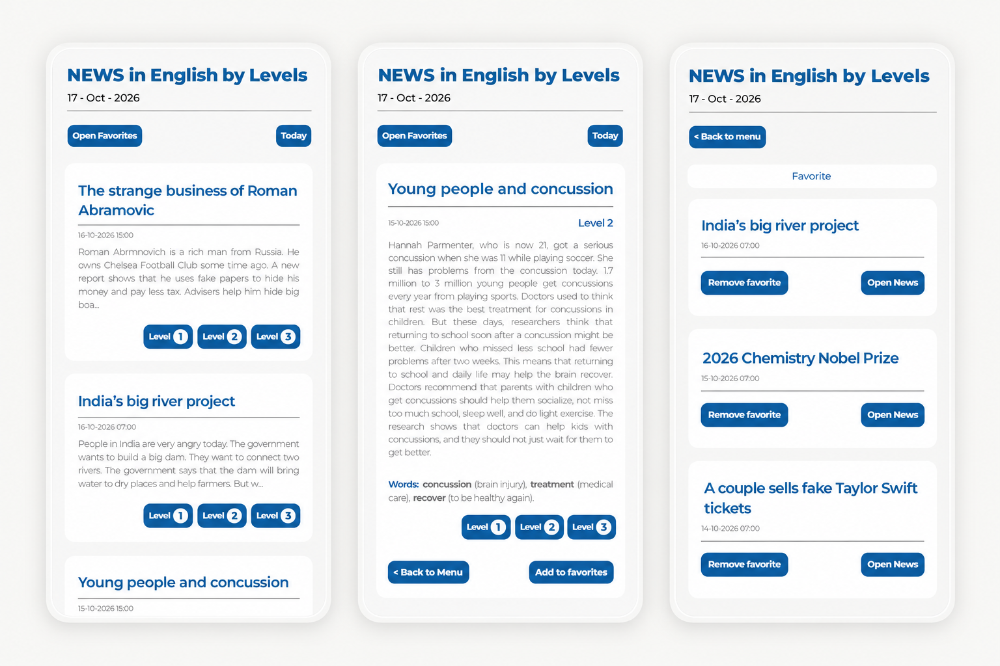

# News in English by Levels

A React application for practising English by reading news at three difficulty levels. Built as an educational and portfolio project.

[Open the live app](https://ytre12.github.io/NewsOnEnglich/) · [Deployment status](https://github.com/ytre12/NewsOnEnglich/actions/workflows/deploy.yml)

## Screenshots

<<<<<<< HEAD


## Features

- Read news at Levels 1, 2, and 3
- Filter articles published today
- Browse articles with pagination
- Save favorite articles in your browser using local storage
=======


## Features

- Read articles at Levels 1, 2, and 3, with vocabulary explanations.
- Filter articles by today's date.
- Browse news with pagination: 10 articles per page.
- Add and remove favorites, saved in the current browser.
- Use responsive layouts on mobile and desktop.
>>>>>>> 7494db8 (add read me)

## Built with

- React for the user interface
- Vite for development and production builds
- Tailwind CSS for styling
- Node.js and Cheerio for scraping news
- localStorage for favorite article IDs
- Oxlint for static code checks
- GitHub Actions and GitHub Pages for automation and hosting

## How it works

1. A Node.js scraper collects articles and their difficulty levels from News in Levels.
2. It merges the results with the existing dataset and writes `data/news.json`.
3. The React app fetches that JSON from this repository's `main` branch through GitHub's raw-content URL.
4. Users browse articles, select levels, and save favorite IDs in localStorage.

The frontend is a static application: it does not require a running Node.js backend. Node.js is used for development, builds, and scraping.

The news-update workflow is scheduled every six hours (UTC) and can also be started manually. Scheduled execution does not guarantee immediate availability of new articles.

## Run locally

### Requirements

- Node.js 24, matching the scraper workflow. The installed Vite version requires `^20.19.0 || >=22.12.0`; not every Node.js 20 release is supported.
- npm and Git
- Internet access to install dependencies and load news

```bash
git clone https://github.com/ytre12/NewsOnEnglich.git
cd NewsOnEnglich
npm ci
npm run dev
```

<<<<<<< HEAD
## News source

News articles are sourced from [News in Levels](https://www.newsinlevels.com/). This project is for educational and portfolio purposes and is not intended for commercial use.
=======
Open the local URL printed by Vite. No `.env` file or API key is required for the current frontend.

Local development loads the remote dataset configured in `src/fetch.js`. Editing or scraping `data/news.json` locally does not automatically change what the frontend displays. To test another dataset, point `DATA_URL` to a URL that serves it.

## Available scripts

| Command | Description |
| --- | --- |
| `npm run dev` | Start the local development server |
| `npm run build` | Create a production build in `dist/` |
| `npm run preview` | Preview the production build locally |
| `npm run lint` | Run static code checks with Oxlint |
| `npm run scrape` | Fetch news and update the local `data/news.json` file |

`preview` is for checking the built application locally, not for hosting a production server. The scraper writes to the dataset; review its changes before committing them.

## Project structure

```text
.github/workflows/   Deployment and news-update workflows
data/               Scraped news dataset
docs/               Screenshots for this README
src/
  components/       UI components and article views
  App.jsx           Application state and screen rendering
  fetch.js          Remote news loading
  localSotre.js     Favorite IDs stored in localStorage
scraper.js          News collection and dataset updates
vite.config.js      Build configuration and GitHub Pages base path
```

## Checking changes

Before submitting or publishing changes, run:

```bash
npm run lint
npm run build
npm run preview
```

Then check the application manually:

- News loads and pagination shows the expected articles.
- Selecting a difficulty level changes the article content.
- Favorites can be added, opened, removed, and restored after reloading.
- The Today filter resets pagination and handles an empty result.
- Loading failures show an error rather than an unusable screen.
- Layouts remain usable on narrow and wide screens.
- Buttons can be reached and activated using the keyboard.

There is currently no automated test suite. A successful build checks compilation, not every user interaction. The deployment workflow currently builds the app but does not run lint or automated tests.

## Deployment

The app is hosted on GitHub Pages using `.github/workflows/deploy.yml`.

1. In the repository's **Settings → Pages**, select **GitHub Actions** as the publishing source.
2. Push frontend changes to `main`, or run the deployment workflow manually from **Actions**.
3. The workflow installs dependencies with `npm ci`, builds the app, and publishes `dist/`.
4. Check the workflow result and open the live site after deployment succeeds.

If the `github-pages` environment requires approval, approve the deployment before it can finish.

The Vite base path is `/NewsOnEnglich/`. When using a different repository name or hosting URL, update `base` in `vite.config.js`. When forking the project, also update the dataset URL in `src/fetch.js` and the links in this README.

### News updates

`.github/workflows/scrape.yml` runs the scraper and commits changes to `data/news.json` when the dataset changes. It needs repository contents-write permission.

To run an update manually, open **Actions → Update News in Levels JSON → Run workflow** and select:

- `recent`: scan recent listing pages; this is the scheduled default.
- `full`: scan the full archive, which takes longer and sends more requests.

The frontend reads the remote JSON at runtime, so dataset updates do not require rebuilding the frontend. Reload the app to fetch the dataset again; remote caching may delay visibility of updates.

### Local scraper configuration

Optional environment variables:

| Variable | Default | Purpose |
| --- | --- | --- |
| `SCRAPE_MODE` | `recent` | Select `recent` or `full` scraping |
| `RECENT_PAGES` | `3` | Number of listing pages to scan in recent mode |
| `CONCURRENCY` | `6` in recent mode, `4` in full mode | Limit concurrent work |
| `REQUEST_TIMEOUT_MS` | `25000` | Request timeout in milliseconds |
| `RETRIES` | `3` | Configure request retry handling |

The GitHub workflow explicitly sets concurrency to `6` for either mode. Keep request volume considerate of the source website. Do not commit credentials or tokens to the repository.

## Troubleshooting

- **Dependencies fail to install:** check your Node.js version and use `npm ci` with the committed lockfile. After intentionally changing dependencies, update and commit `package-lock.json` as well.
- **Deployment fails or waits:** open the failed step in Actions and check whether the Pages environment needs approval.
- **News is missing or outdated:** check the news-update workflow, the remote JSON URL, and browser network errors. The app hides articles without Level 1 vocabulary.
- **Local JSON edits do not appear:** the frontend loads the remote dataset, not the local file.
- **A push is rejected after a news update:** the scraper may have committed new data to `main`. Save your local work and integrate remote changes before pushing; do not overwrite them with a force push.

## Known limitations

- Favorites are stored only in the current browser and site origin; they do not sync across devices. Clearing browser storage removes them.
- News availability depends on the source website, scraping workflow, and remote dataset access.
- The Today filter compares article dates with the user's local calendar date, calculated when the app opens. Reload after midnight to refresh it.
- Article selection and difficulty level are not stored in the URL. Reloading resets the current reading view, and individual articles do not yet have shareable app links.
- Automated behavior tests are not yet implemented.

## Roadmap

These are planned improvements, not existing features:

- [ ] Validate incoming news data and add a retry action for loading failures.
- [ ] Add URL-based navigation for articles, levels, and favorites.
- [ ] Add automated tests for core reading and favorites flows.
- [ ] Run lint and tests in CI before deployment.
- [ ] Improve keyboard accessibility and pagination for large datasets.
- [ ] Add search by article title.

## Content source

News articles and vocabulary are sourced from [News in Levels](https://www.newsinlevels.com/).

This is an independent educational and portfolio project. It is not affiliated with or endorsed by News in Levels. Article records include links to the original source.

## License

A license for this project's original code has not yet been selected. No `LICENSE` file is currently included.

Third-party news content is separate from the application code and is not covered by a code license for this project.
>>>>>>> 7494db8 (add read me)
